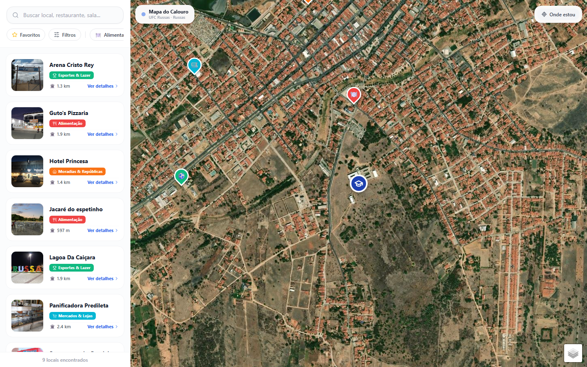
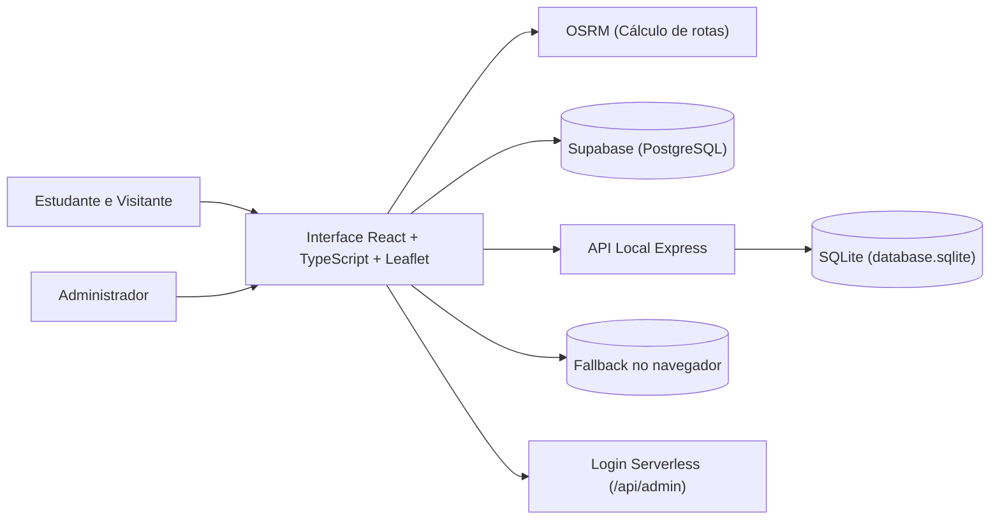

# Mapa do Calouro · Guia e localização para a UFC Russas

**Busca de locais, avaliações e traçado de rotas para estudantes e visitantes do campus e da cidade de Russas.**

O Mapa do Calouro reúne, em uma interface cartográfica interativa, pontos de interesse acadêmicos, serviços essenciais, moradia, alimentação e lazer próximos à Universidade Federal do Ceará (Campus Russas). O projeto conecta a consulta rápida no mapa — com filtros por categoria, favoritos e cálculo de rotas — a um painel administrativo para manutenção do catálogo.

[Produto](#o-produto) · [Minha contribuição](#minha-contribuição-e-uso-de-ia) · [Arquitetura](#arquitetura) · [Execução local](#executar-localmente) · [Qualidade](#qualidade-e-evidências) · [Documentação](#documentação)



*Demonstração local com nove locais do banco SQLite. [Veja também as telas de busca e mobile](docs/SCREENSHOTS.md).*

<details>
<summary>Sobre a captura e os créditos do mapa</summary>

Nesta captura, os dados do SQLite são fornecidos à interface por uma interceptação da API no navegador. Os detalhes da sessão estão no [registro das imagens](docs/SCREENSHOTS.md).

Satélite: Tiles © Esri — Source: Esri, i-cubed, USDA, USGS, AEX, GeoEye, Getmapping, Aerogrid, IGN, IGP, UPR-EGP, and the GIS User Community.

</details>

## O problema

Quem chega a uma nova cidade universitária precisa localizar blocos acadêmicos, restaurantes, farmácias, paradas de ônibus e serviços públicos sem conhecer a geografia local. Quando essas referências ficam espalhadas em grupos de mensagens ou listas estáticas, o estudante não consegue visualizar facilmente a proximidade entre os pontos nem traçar o deslocamento a partir do campus.

O Mapa do Calouro centraliza essas informações sobre o mapa de Russas, permitindo filtrar categorias, consultar avaliações da comunidade e calcular rotas a partir da UFC ou da localização atual do dispositivo.

## O produto

| Experiência | Recursos presentes no projeto |
| --- | --- |
| **Exploração e navegação** | Mapa interativo (satélite e rua), busca textual, filtro por categorias com contagem, detalhes do local, notas, comentários, favoritos e traçado de rotas |
| **Painel administrativo** | Criação, edição e exclusão de locais e categorias, além de preenchimento assistido a partir de coordenadas ou links do Google Maps |

### Fluxos principais

- **Descoberta e filtragem:** busca simultânea por nome, endereço ou categoria, com atualização imediata dos marcadores no mapa e da listagem lateral.
- **Rotas e deslocamento:** solicitação de trajeto tendo como origem o campus da UFC Russas ou o GPS autorizado pelo navegador, exibindo distância, tempo estimado e geometria da rota no mapa.
- **Avaliações e favoritos:** consulta e envio de notas e comentários por local, além de marcação de favoritos persistidos no navegador.
- **Cadastro assistido por link:** extração de coordenadas e metadados a partir de URLs do Google Maps no painel administrativo para reduzir o preenchimento manual.

## Decisões de engenharia

| Desafio | Abordagem | Evidência no código |
| --- | --- | --- |
| Operar com diferentes fontes de dados | Camada de acesso capaz de alternar entre Supabase, API local em Express/SQLite e armazenamento local como contingência | [Cliente de dados](src/lib/api.ts) e [API local](server/index.js) |
| Lidar com indisponibilidade do serviço de rotas | Consulta ao OSRM para traçado viário com fallback para estimativa geométrica de distância e tempo | [Utilitários de mapa](src/lib/mapUtils.ts) e [cálculo de distância](src/lib/distance.ts) |
| Agilizar o cadastro de novos locais | Parser programático de URLs e coordenadas do Google Maps combinado a consultas externas de geocodificação | [Painel administrativo](src/components/Admin.tsx) |
| Adaptar a navegação para desktop e celular | Sincronização entre seleção de marcador, gaveta de detalhes e barra lateral retrátil em telas menores | [Estado principal](src/App.tsx), [mapa](src/components/MapView.tsx) e [sidebar](src/components/Sidebar.tsx) |
| Validar fluxos críticos da aplicação | Suíte de testes cobrindo filtros, cálculo de distância, favoritos, CRUD administrativo e cenários E2E | [Testes Vitest](tests) e [especificações Playwright](e2e) |

## Minha contribuição e uso de IA

Desenvolvi o Mapa do Calouro individualmente, utilizando **Pen.dev**, **Bolt** e **Claude** como ferramentas de apoio ao longo do ciclo de engenharia. Minha atuação concentrou-se na definição do produto, nas decisões arquiteturais, na integração entre camadas e na revisão técnica do código entregue.

- **Prototipação e interface (`Claude` e `Bolt`):** uso de IA como apoio para estruturar a disposição visual dos componentes em React e Tailwind CSS, ajustando a experiência de mapa em tela cheia, os painéis laterais e o comportamento responsivo entre desktop e mobile.
- **Implementação de regras e integrações (`Claude`):** apoio na escrita e refatoração dos módulos de integração com o Leaflet, consumo do serviço de rotas OSRM, extração de coordenadas de links do Google Maps (`parseGoogleMapsInput`) e comunicação com Supabase e SQLite.
- **Direção técnica e curadoria de escopo:** avaliação crítica das soluções propostas pelas ferramentas para garantir tratamento de falhas (como o fallback quando a rota externa não responde ou quando um banco remoto não está configurado) e remoção de funcionalidades experimentais que desviavam do objetivo central do guia.
- **Verificação e qualidade:** condução da checagem estática de tipos, execução e manutenção dos testes automatizados e validação visual dos fluxos em navegador.

O histórico de commits, o escopo exato das verificações e o detalhamento sobre o uso das ferramentas estão documentados no [estudo de caso do portfólio](docs/PORTFOLIO.md).

## Arquitetura



A interface concentra a renderização cartográfica, o estado de busca e a seleção de rotas. Na persistência, a aplicação suporta tanto uma operação conectada ao **Supabase** quanto a execução local apoiada por **Express e SQLite**, além de manter favoritos e contingência no armazenamento do navegador.

| Camada | Tecnologias |
| --- | --- |
| Interface | React, TypeScript, Vite e Tailwind CSS |
| Mapa e rotas | Leaflet, Esri/OpenStreetMap Tiles e OSRM |
| Persistência e backend | Supabase (PostgreSQL), Express, SQLite e função serverless em `api/` |
| Verificação | Vitest, Testing Library, Playwright, ESLint e TypeScript |

```text
src/
  components/          Mapa (MapView), barra lateral, detalhes do local e painel administrativo
  lib/                 Acesso a dados (api.ts), rotas (mapUtils.ts), distâncias e favoritos
  types/               Contratos TypeScript de locais, categorias e avaliações
server/                API local com Express, SQLite e script de exportação para Supabase
api/admin/             Endpoint serverless de autenticação administrativa
supabase/migrations/   Esquema SQL de locais, categorias e avaliações
tests/                 Testes unitários e de integração com Vitest
e2e/                   Testes de navegação com Playwright
docs/                  Estudo de caso, requisitos (SRS), capturas e guias operacionais
```

## Executar localmente

### 1. Instalar as dependências e iniciar a interface

Com Node.js e npm instalados, execute na raiz do projeto:

```bash
git clone https://github.com/Felipecoder07/mapa-calouro.git
cd mapa-calouro
npm ci
npm run dev
```

Abra o endereço indicado pelo Vite (por padrão, `http://localhost:5173`).

### 2. Iniciar a API local (SQLite)

Para utilizar o catálogo local armazenado em `data/database.sqlite`, inicie o servidor Express em outro terminal:

```bash
npm run server
```

O servidor responde na porta `3001` e recebe as chamadas encaminhadas pelo proxy do Vite em `/api`. Sem o Supabase configurado ou a API local ativa, o catálogo inicial de locais no navegador permanece vazio.

### 3. Configuração opcional do Supabase e autenticação

Para conectar ao Supabase, utilize [.env.example](.env.example) como referência e defina `VITE_SUPABASE_URL` e `VITE_SUPABASE_ANON_KEY` em um arquivo `.env.local`.

Para o painel administrativo, defina a variável `ADMIN_PASSWORD` diretamente no ambiente do terminal antes de iniciar `npm run server`, pois o processo local do servidor não carrega o arquivo `.env` automaticamente.

> No PowerShell, caso a execução de `npm.ps1` esteja bloqueada pela política do sistema, utilize `npm.cmd` no lugar de `npm`.

## Qualidade e evidências

```bash
# Verificação estática de tipos
npm run typecheck

# Suíte de testes com Vitest
npm test

# Build de produção
npm run build

# Testes de ponta a ponta com Playwright
npm run test:e2e
```

Na revisão registrada em 05/11/2026, a checagem de tipos e os **57 testes distribuídos em 11 arquivos do Vitest** foram aprovados, cobrindo filtros da barra lateral, cálculos de distância, favoritos, operações administrativas e rotas de API. Após a consolidação do escopo principal, a tipagem, o build de produção e a renderização em Chromium foram novamente conferidos.

Os detalhes sobre o ambiente de teste, o uso de simulações (*mocks*) e o alcance de cada verificação estão documentados em [docs/PORTFOLIO.md](docs/PORTFOLIO.md#validação-desta-revisão).

## Estado e próximos passos

O repositório entrega a aplicação funcional para execução local e demonstração documentada por testes e capturas de tela.

Para publicar uma instância aberta ao público, os próximos passos incluem restringir o token de desenvolvimento aceito na autenticação da API local, revisar as políticas de escrita (*RLS*) descritas no guia do Supabase e monitorar a disponibilidade dos provedores externos de mapas e rotas.

## Documentação

| Documento | Conteúdo |
| --- | --- |
| [Apresentação do projeto](docs/APRESENTACAO.md) | Narrativa do produto, imagens principais e roteiro de demonstração |
| [Estudo de caso e uso de IA](docs/PORTFOLIO.md) | Histórico técnico, contribuição do autor, uso de IA e registro de validação |
| [Capturas de tela](docs/SCREENSHOTS.md) | Telas em desktop e mobile com contexto de execução |
| [Especificação de requisitos (SRS)](docs/ESPECIFICACAO_REQUISITOS_SRS.md) | Requisitos funcionais e não funcionais do sistema |
| [Guia de deploy](docs/GUIA_DEPLOY_PRODUCAO.md) | Procedimento de configuração e publicação |
| [Manutenção do Supabase](docs/MANUTENCAO_KEEPALIVE_SUPABASE.md) | Automação de *keep-alive* do banco via GitHub Actions |

---

Desenvolvido por **Luiz Felipe Verissimo** · [Felipecoder07](https://github.com/Felipecoder07).
