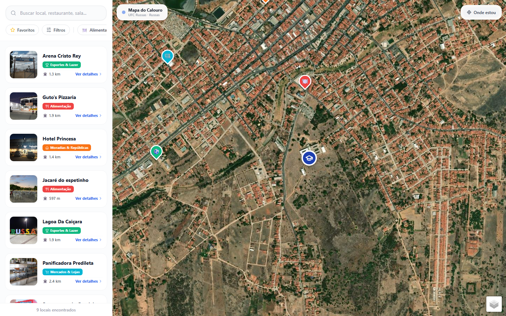
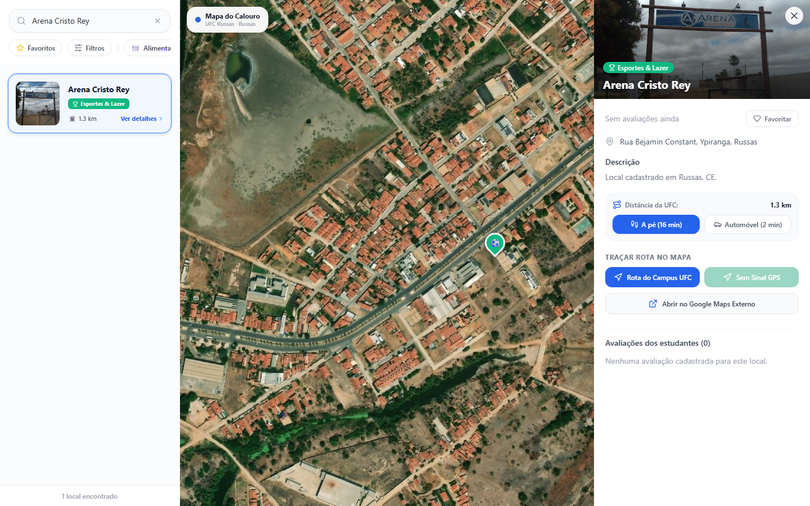
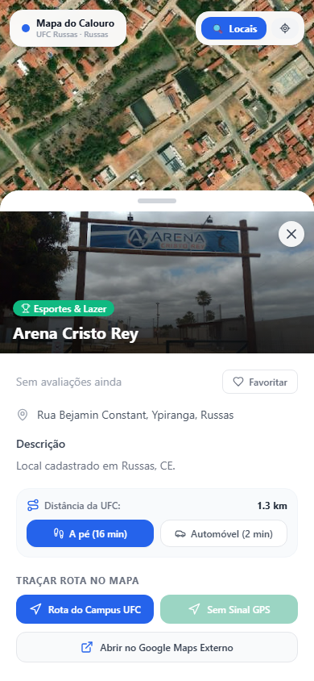

# Mapa do Calouro

**Guia de locais e serviços da UFC Campus Russas**  
Luiz Felipe Verissimo · Projeto individual · Portfólio AI Builder

## O problema

Chegar a um campus envolve descobrir onde ficam espaços acadêmicos e serviços do cotidiano. O Mapa do Calouro reúne essas informações em uma interface geográfica para estudantes e visitantes da UFC Russas.

## A solução

Mapa com busca, filtros por categoria, detalhes dos locais, favoritos e consulta de rotas. Um painel administrativo permite manter locais e categorias.

*Interface desktop em demonstração local, com nove locais do SQLite. Imagens de satélite: créditos abaixo.*

## A jornada

O usuário busca um local, consulta suas informações e pode solicitar uma rota desde a universidade ou de sua localização autorizada.

*Busca e detalhes na aplicação executada. A captura mostra os controles de rota; não demonstra uma rota calculada.*

*A mesma consulta em viewport mobile de navegador.*

## Minha contribuição e uso de IA

Desenvolvi o Mapa do Calouro como projeto individual. Usei Pen.dev e Claude durante o desenvolvimento. A entrega reúne interface, integração de dados e gestão de conteúdo em uma aplicação web.

O histórico disponível registra 25 commits em meu nome, incluindo evolução da navegação, preenchimento de cadastros, persistência e ajustes mobile. O uso das ferramentas de IA é meu relato; os registros disponíveis não permitem atribuir cada alteração a uma ferramenta ou reproduzir as conversas originais.

## Evidências da entrega

| Aspecto | Evidência |
| --- | --- |
| Interface | Três capturas reais de mapa, busca e detalhes |
| Evolução | Commits e arquivos relacionados no [case técnico](PORTFOLIO.md#evolução-técnica) |
| Verificação local | TypeScript sem erros na checagem; 57 testes aprovados em 11 arquivos |
| Construção com IA | Uso de Pen.dev e Claude declarado pelo autor |

O projeto permite apresentar uma solução concreta e seu percurso técnico. Os testes incluem simulações e não equivalem a validação completa de produção. Esta apresentação não atribui números de adoção, economia de tempo ou impacto ao projeto.

## Texto curto para o portfólio

> **Mapa do Calouro — UFC Russas:** desenvolvi individualmente um guia web de locais e serviços com mapa, busca por categorias, detalhes, favoritos, consulta de rotas e painel de gestão. Usei Pen.dev e Claude durante o desenvolvimento. O projeto combina React, TypeScript e Leaflet com integração de dados via Supabase e API Express/SQLite. Apresento capturas reais da interface, histórico de evolução e validação local com checagem de tipos e 57 testes aprovados. O uso de IA é relatado por mim; não há métricas de adoção ou impacto publicadas nesta apresentação.

## Fala sugerida — aproximadamente 90 segundos

> O Mapa do Calouro é um projeto individual que desenvolvi para reunir informações de locais e serviços da UFC Campus Russas e arredores. A ideia é ajudar quem está chegando a encontrar essas informações em uma interface com mapa.
>
> A jornada começa pela busca ou pelas categorias. Ao selecionar um local, a pessoa encontra detalhes e opções para consultar uma rota desde a universidade ou da sua localização. Há também favoritos, avaliações e um painel para gerenciar o conteúdo.
>
> Usei Pen.dev e Claude durante o desenvolvimento. A implementação reúne React, TypeScript e Leaflet, com integração ao Supabase e a uma API local com SQLite. O histórico mostra a evolução da navegação, do preenchimento de cadastros e da persistência de dados.
>
> Estas imagens são capturas da aplicação executada, com dados do banco local em uma sessão de demonstração. Na revisão, a checagem de tipos e os 57 testes passaram. Parte dos testes usa simulações, então esse resultado tem um escopo local.
>
> Para o portfólio AI Builder, apresento a construção de uma solução concreta com apoio de IA, o código e as evidências disponíveis. Ainda não apresento métricas de adoção ou impacto.

## Contexto das imagens e referências

Capturas de 05/11/2026 na cópia de trabalho baseada em `d341dc0`, após a remoção da gamificação. Dados do SQLite servidos por interceptação da API no navegador; Supabase bloqueado e avaliações vazias. As imagens demonstram a interface, não o backend ou um deploy público.

**Satélite:** Tiles © Esri — Source: Esri, i-cubed, USDA, USGS, AEX, GeoEye, Getmapping, Aerogrid, IGN, IGP, UPR-EGP, and the GIS User Community. Manter o crédito ao reutilizar as imagens.

- [Case técnico e limites das evidências](PORTFOLIO.md)
- [Procedência e reprodução das capturas](SCREENSHOTS.md)
- [Documentação do projeto](README.md)
